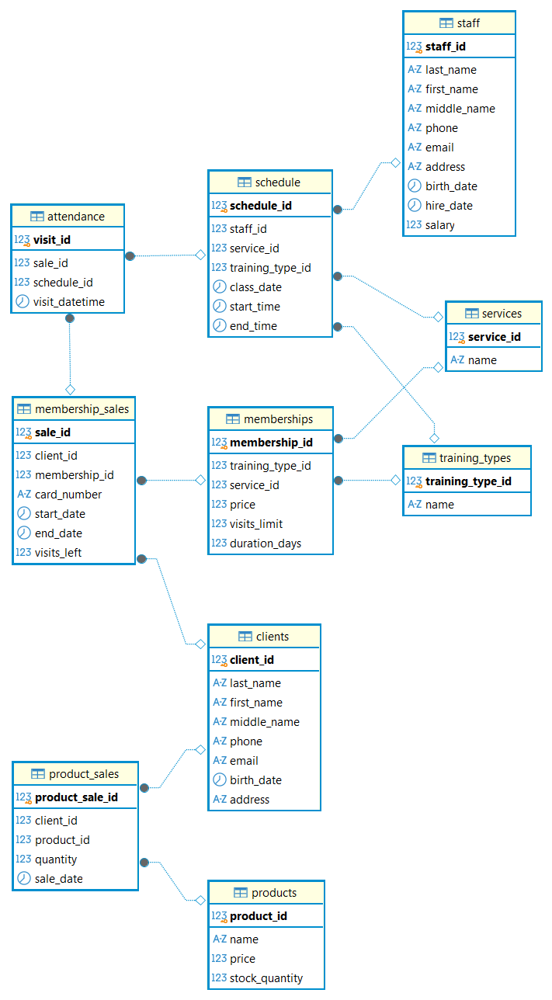

# Fitness Club Database (База данных фитнес-клуба)

Учебный проект, демонстрирующий навыки проектирования реляционных баз данных, нормализации и написания SQL-скриптов.

## Стек технологий и инструменты
* **СУБД:** PostgreSQL
* **Клиент:** DBeaver
* **Язык:** SQL (DDL, DML)

## Текущий статус проекта
На данный момент реализовано:
- [x] Проектирование логической и физической структуры БД (10 таблиц).
- [x] Написание DDL-скриптов для создания таблиц (справочники, основные сущности, транзакционные таблицы).
- [x] Настройка связей (внешние ключи, ограничения `CHECK`, `UNIQUE`).
- [x] Генерация реалистичных тестовых данных (DML).
- [x] Построение ER-диаграммы.

## Структура проекта
* `sql/01_schema.sql` — скрипты создания структуры БД (таблицы, связи, ключи).
* `sql/02_insert_test_data.sql` — скрипты заполнения таблиц тестовыми данными.
* `sql/03_simple_queries.sql` — скрипты на простые выборки и фильтрации (SELECT, WHERE, ORDER BY, LIKE).
* `sql/04_group_queries.sql` — скрипты с использованем агрегаций и группировки (COUNT, SUM, AVG, GROUP BY).
* `sql/05_join_queries.sql` — скрипты на соединение таблиц (INNER JOIN, LEFT JOIN).
* `docs` — папка с ER-диаграммой проекта.

## ER-диаграмма

*(Если картинка не отображается в предпросмотре, она лежит в папке docs)*

## Описание сущностей
База данных моделирует работу фитнес-клуба и включает в себя следующие блоки:
* **Справочники:** `training_types` (виды тренировок), `services` (услуги).
* **Участники:** `clients` (клиенты), `staff` (сотрудники/тренеры).
* **Товары и услуги:** `products` (товары в магазине), `memberships` (типы абонементов).
* **Бизнес-процессы:** `membership_sales` (продажа абонементов), `schedule` (расписание занятий), `attendance` (учет посещений), `product_sales` (продажи товаров).

## Планы по развитию
- [ ] Добавление аналитических SQL-запросов (JOIN, GROUP BY, оконные функции) для формирования отчетов.
- [ ] Создание представлений (Views) для часто используемых запросов.
- [ ] Написание хранимых процедур (если потребуется).

